# Deep Contrastive Vision-Language Alignment Pipeline

This document details the architecture and operational lifecycle of the **Deep Contrastive Vision-Language Alignment Pipeline** powering **CapAI**.

---

## 1. Pipeline Architecture Overview

The system employs a **Dual-Tower Vision-Language Transformer** to project disparate modalities (spatial pixel arrays and semantic textual sequences) into a normalized continuous metric space. By measuring the cosine distance between the visual projection vector and candidate textual projection vectors, the engine selects the candidate with maximum semantic affinity to the image.

```mermaid
sequenceDiagram
    autonumber
    actor User as User / Browser
    participant UI as Frontend Interface (app.js)
    participant Server as Application Server (app.py)
    participant Matrix as Contextual Style Matrix (caption_bank.json)
    participant Engine as Multi-Modal Contrastive Embedding Engine

    User->>UI: Uploads image & selects Platform, Tone, Keyword, & Hashtags
    UI->>Server: POST /api/generate_caption (multipart/form-data)
    
    rect rgb(20, 24, 39)
        Note over Server,Matrix: Step 1: Style Space Filtering
        Server->>Matrix: Query Platform ('Instagram', 'LinkedIn', 'X') & Tone ('Professional', 'Witty', 'Minimalist')
        Matrix-->>Server: Filtered Candidate Caption Pool (3-4 domain phrases)
    end

    rect rgb(30, 27, 75)
        Note over Server,Engine: Step 2: Dual-Tower Contrastive Alignment
        Server->>Engine: compute_similarity_alignment(image, candidate_pool)
        Engine->>Engine: Visual Tower: Extract spatial image feature embedding
        Engine->>Engine: Text Tower: Tokenize & encode candidate textual sequences
        Engine->>Engine: Project vectors into joint continuous latent metric space
        Engine->>Engine: Compute pairwise cosine similarity matrix
        Engine-->>Server: Top-1 Ranked Caption + Alignment Confidence Score
    end

    rect rgb(20, 24, 39)
        Note over Server: Step 3: Synthesis & Contextual Injection
        Server->>Server: Append keyword naturally: " | [Keyword]" (if provided)
        Server->>Server: Append 3 platform-appropriate hashtags (if toggled)
    end

    Server-->>UI: Return single, formatted caption string (JSON)
    UI->>User: Elegantly renders single best recommended caption
```

---

## 2. Detailed Execution Steps

### Step 1: Contextual Style Matrix Filtering
When a user submits an image with target attributes:
- The server retrieves the **Contextual Style Matrix** (`engine/caption_bank.json`).
- It extracts a subset of candidate captions strictly matching the requested **Platform** (`Instagram`, `LinkedIn`, `X`) and **Tone** (`Professional`, `Witty`, `Minimalist`).
- This constraints the candidate search space to 3–4 linguistically tailored phrases, guaranteeing that generated captions remain on-brand and platform-optimized.

### Step 2: Dual Projection Latent Metric Alignment (Single or Multi-Image Batch)
The uploaded images (one or more) and candidate text pool are processed by the `ContrastiveEmbeddingEngine`:
1. **Visual Embedding Pipeline**:
   - Each input image is preprocessed, normalized, and encoded through the visual transformer tower.
   - Spatial visual tokens are pooled and projected into shared latent embedding vectors $v_{I_k} \in \mathbb{R}^d$ for each image $k \in \{1, \dots, N\}$.
   - Vectors are $L_2$-normalized: $\hat{v}_{I_k} = \frac{v_{I_k}}{\|v_{I_k}\|_2}$.
2. **Textual Embedding Pipeline**:
   - Each candidate string $t_i$ is tokenized, padded, and encoded through the language transformer tower.
   - Text representations are projected into the identical shared latent space: $v_{T_i} \in \mathbb{R}^d$.
   - Normalized: $\hat{v}_{T_i} = \frac{v_{T_i}}{\|v_{T_i}\|_2}$.
3. **Cross-Modal Cosine Similarity Alignment**:
   - Pairwise cross-modal cosine similarity matrix is computed across all images and candidates:
     $$\text{sim}(I_k, T_i) = \hat{v}_{I_k} \cdot \hat{v}_{T_i}$$
   - For multi-image carousels/collections, the cross-modal similarity is averaged across the images dimension:
     $$\overline{\text{sim}}(T_i) = \frac{1}{N} \sum_{k=1}^N \text{sim}(I_k, T_i)$$
   - The candidate with the highest collective affinity is selected:
     $$T^* = \arg\max_{T_i} \overline{\text{sim}}(T_i)$$

### Step 3: Natural Keyword Injection
If the user provided an optional focus keyword (e.g., `Sunset`, `Productivity`, `Innovation`), the server seamlessly appends it to the matched base sentence using structured pipe delimiters:
$$\text{Caption}_{\text{injected}} = T^* + \text{" | [" + Keyword + "]"}$$

### Step 4: Generic Platform Hashtags Appending
If the `generate_hashtags` toggle is enabled, 3 curated, platform-appropriate hashtags are attached to the tail of the caption string:
- **Instagram**: `#visuals #aesthetic #explorepage`
- **LinkedIn**: `#leadership #innovation #professional`
- **X**: `#trending #perspective #vibes`

### Step 5: Frontend Display
The resulting single formatted caption is transmitted to the client and rendered in the prominent **Recommended Caption** card with live token and character metrics, ready for one-click clipboard copying.
